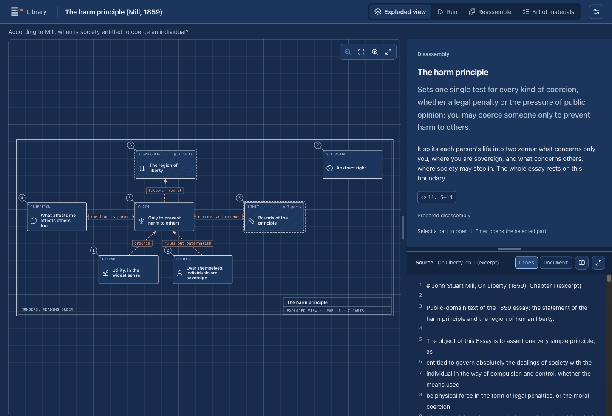

# Break the Wall

**Take apart whatever you want to understand (a source, a repository, a topic) and see how its parts work together. You have understood it when you can put it back together.**

Break the Wall turns a wall of text into a **disassembly**: an exploded view of 3–7 parts per level, joined by typed joints, each part tied to the exact lines of its source. You **run** the mechanism by predicting what happens before each step, or by removing a brick from an argument to see whether it falls. When you are ready, you **reassemble** it. One loop for any subject: only the kind of joint changes (mechanism, argument, story).

**[Product](docs/product.md)** · **[Architecture](docs/architecture.md)** · **[Development](docs/development.md)** · **[Plan](docs/workflow/plans/P-20261024-disassembly/plan.md)** · **[Status](STATUS.md)**




> [!NOTE]
> Break the Wall is an alpha that runs from source on macOS. There is no installer or release yet. The prepared disassemblies work without any account. **Generating disassemblies from your own sources is built and tested, but not yet witnessed live:** the comparison of ChatGPT models and the first real generations are the next step.

## Table of contents

- [Why Break the Wall?](#why-break-the-wall)
- [Features](#features)
  - [The disassembly](#the-disassembly)
  - [Run](#run)
  - [Reassemble](#reassemble)
  - [Bill of materials](#bill-of-materials)
  - [Two themes, two languages](#two-themes-two-languages)
  - [Generation](#generation)
  - [Progress and privacy](#progress-and-privacy)
- [Local models](#local-models)
- [Getting started](#getting-started)
- [Tech stack](#tech-stack)
- [Project status](#project-status)
- [Roadmap](#roadmap)
- [Contributing](#contributing)
- [License](#license)

## Why Break the Wall?

AI answers often arrive as a wall of text: correct-sounding, hard to retain and hard to check. Reverse engineering takes software apart, with evidence for every finding, so you can understand and rebuild it. Break the Wall applies the same principle to knowledge: **disassemble → run → reassemble**, with every part tied to its source.

It is not a course, a summarizer, a chatbot or a flashcard app. Review is there only if you want it. See the [product definition](docs/product.md).

| | A chat answer | Break the Wall |
|---|:---:|:---:|
| The whole as an exploded view of 3–7 parts, with sub-assemblies | ❌ | ✅ |
| Joints that say how parts connect: sends to, causes, supports, attacks, leads to… | ❌ | ✅ |
| Every part linked to exact source lines | ❌ | ✅ |
| Predict before each step runs; remove a brick and see if the claim falls | ❌ | ✅ |
| A bill of materials that accounts for every line of the source | ❌ | ✅ |
| Progress, runs and notes that resume after restart | ❌ | ✅ |

> [!IMPORTANT]
> Citations are verified; explanations are not. The app checks that every cited line exists in your source, and that every line is either in a part or excluded with a reason. A wrong explanation can still sit next to a correct citation, so read the highlighted lines.

## Features

### The disassembly

- **Exploded view:** the parts drawn as plates on a technical sheet, with balloons, a title block and an automatic layout. Mechanisms and stories run left to right; arguments stack, with the claim above its grounds and attacks or limits beside it.
- **Numbers in reading order:** a part's number follows the arrows: the flow of a mechanism, grounds before the claim they support, the events of a story. The bill of materials numbers parts the same way ("2.1.3").
- **Room to read:** drag the bar under the drawing to make the plates bigger, and the bar between the card and the source to share the row. Sizes are remembered on this device. Inside a sub-assembly, the ↑ control, Escape or Alt+↑ goes back to the level above.
- **Sub-assemblies, as deep as the source goes:** a part can open into its own 3–7 parts, and so on, level after level. Every level accounts for its parent's lines. A part with at least 6 lines of its own can be taken apart on request ("Take this part apart", one small request); a smaller one says why it stops there. Parts outside your question stay closed and hatched, but you can still open them.
- **Three kinds of joint:** mechanism (sends to, causes, depends on), argument (supports, attacks, limits) and story (leads to, because). Each kind has a color, a line style and an end mark, so color is never the only cue.
- **Part card:** a short lead (what the part is for), then 2–4 points that add the details, marked → (then), = (stays the same) or ⚠ (caution), and an optional lens, metaphor with its limit, and critical note. It also lists the part's joints in words, its citations and your notes.
- **Source pane:** numbered lines, the cited lines highlighted, page breaks for documents, and a file picker when there are many sources. A markdown or text source can also be read as a document, beside the card or in a full-window reader with an outline: tables and Mermaid diagrams are drawn, and citations highlight their blocks. HTML inside a source is shown as text, links are not followed and images are not fetched.

### Run

- **Scenario:** a setup and instruments (for example `staging: digest A`), then one step at a time. Before a step runs you predict what happens. The step's parts then show as running and its effects land: states, instruments and the explanation, with its source lines.
- **Load test:** remove one brick at a time and see whether the target **falls**, **weakens** or **holds**. Interpretations that the text does not state are labelled.
- **New case:** apply the disassembly to a situation it does not describe, labelled as a constructed case.

### Reassemble

Optional. The drawing keeps its shape but loses its names; put the parts back by click or drag. The tray never starts in solution order, and item numbers are hidden. A wrong placement names the part with its hint. Interchangeable parts, such as three independent supports, can go in any of their slots.

### Bill of materials

Every source line is in a part, in a joint, or excluded with a reason: context, outside the question, repetition, detail, contains secrets, generated. The view shows the scope (a repository snapshot or a document's pages), a strip per source, the items with their line ranges, and file-level exclusions. It also shows the app's own check, which names any forgotten range.

### Two themes, two languages

- **Paper** (light) and **blueprint** (dark), following the system or chosen in the header. Every text color reaches WCAG AA in both themes, checked by a test.
- **English and Italian** interface, following the system or chosen in the header. Content keeps its own language and is never translated by the app. When a disassembly exists in both languages, the player offers the other version, and progress stays separate for each version.

### Generation

Studio takes apart pasted text or `.txt` / `.md` files around your question, in three phases:
1. **Structure:** the parts, their joints and the bill of materials. The app checks it line by line before going on.
2. **Parts:** one request per top-level part, carrying only that part's lines.
3. **Runs:** scenarios, load tests or cases, and the reassembly hints.

Each phase can be repaired once with the app's findings. When the repair leaves only texts a few characters too long, one small request shortens just those. Nothing is saved as a disassembly unless the whole of it passes.

- **Suggested break-downs:** on the question step, "Suggest break-downs" sends one request and proposes 3–5 questions, each with its kind (mechanism, argument, story) and the parts it would give. Choosing one fills the question field, which you can still edit. Nothing is sent until you press the button.
- **The drawing while it is written:** once the structure is accepted, Studio draws the top level, and each plate shows whether its part is waiting, being written, done or failed. A part that is done opens its lead and points.
- **Resume:** a failed or cancelled generation keeps what was accepted (structure, parts, runs) in one draft file in the app's data folder. Studio says what was kept and offers "Resume", which asks only for what is missing, or "Start over". The draft is deleted on success and when a new generation starts.
 You choose the content language (by default, your question's), and you can give the structure and the parts different models, for example a cheaper one for the parts. There are two routes:

| Route | Account | Where your source goes | Status |
|---|---|---|---|
| **ChatGPT** | Sign in with ChatGPT; uses your plan | OpenAI, over the documented Responses API | Sign-in witnessed; lessons generated live by the evaluation runner; disassemblies not yet run live |
| **Local model** | none | a server on `127.0.0.1` on your Mac | Witnessed for lessons; disassemblies not yet measured |

Lessons created before disassemblies stay readable, with their progress, under "Earlier paths".

### Progress and privacy

- **Storage:** disassemblies, lessons, progress and notes stay on your device, written atomically. Progress that no longer matches its disassembly is kept on disk and the session restarts, with a notice.
- **Interrupted generations:** at most one draft, `generation-draft.json`, with the text generated so far. It never leaves the device and is deleted on success, on "Start over" and when a new generation starts.
- **Credentials:** ChatGPT tokens are encrypted with the macOS Keychain (Electron `safeStorage`) and never reach the interface or the logs.
- **Isolation:** the renderer has no Node, filesystem or network access. Every desktop operation goes through narrow, validated IPC calls.

## Local models

Start a model server, open **Create a path → Generation → Local model**, and the app finds it. It probes the default ports and identifies each runtime by its own endpoints. Before first use, it sends a tiny probe to check whether the server really enforces the output format.

| Runtime | Default address | How the format is enforced | Observed on Ollama 0.30.8 / llama.cpp b9509 |
|---|---|---|---|
| llama.cpp server | `127.0.0.1:8080` | `/completion` with `json_schema` | ✅ enforced |
| LM Studio | `127.0.0.1:1234` | `response_format` JSON Schema | not yet tested |
| Ollama | `127.0.0.1:11434` | `format` | depends on the model: ✅ Qwen3.6, ⚠️ ignored for LFM2.5 (the app warns) |
| Other OpenAI-compatible server | any loopback port | `response_format` JSON Schema | depends on the server |

Measured on an M4 Pro with 48 GB, using Qwen3.6-35B-A3B (Q4_K_M) through llama.cpp: a lesson took about 1–2 minutes. Disassemblies have not been timed yet. Details are in the [local inference trial](docs/workflow/research/R-20261022-local-inference.md).

```bash
llama-server -m Qwen3.6-35B-A3B-Q4_K_M.gguf -c 32768
```

> [!TIP]
> Use a model with at least ~30B parameters and a 32k context. Plan for 32 GB of memory or more. Only addresses on this machine are accepted, so your source never leaves the computer on this route.

## Getting started

**Requirements:** macOS, Node.js 22.23.2 and npm 10.9.8 (versions pinned in `package.json`).

```bash
npm ci
npm run build
npm start
```

**Development**

```bash
npm run dev       # Vite + Electron with reload
npm run check     # strict TypeScript + Vitest
npm run dev:web   # renderer only, in a browser (no generation)
npm run eval      # measure generation on fixed cases (see Local development)
```

Set `BTW_USER_DATA_DIR` to an absolute path to keep test data separate from your own. More details are in [Local development](docs/development.md).

## Tech stack

| Layer | Stack |
|---|---|
| Desktop host | Electron 45: sandboxed renderer, context isolation, custom `btw://` protocol |
| Interface | React 19, TypeScript 7, Vite 8, SVG technical drawings, lucide icons, system fonts; markdown-it for sources read as documents, Mermaid for their diagrams (loaded on first use) |
| Disassembly model | zod 4 contract with located findings, bill-of-materials check, deterministic layered layout and pure run/reassembly transitions; independent of React and Electron |
| AI routes | Sign in with ChatGPT (OAuth + PKCE, Responses API); Ollama, LM Studio and llama.cpp over loopback |
| Storage | atomic JSON files in the app's data folder; credentials via Keychain-backed `safeStorage` |
| Tests | Vitest, Testing Library (jsdom): contract, layout geometry, contrast, catalogs, player interactions |

## Project status

Work follows the approved [plan P-20261024-disassembly](docs/workflow/plans/P-20261024-disassembly/plan.md) (v6). Evidence for each task is in its implementation record.

| Phase | Tasks | Status |
|---|---|---|
| Contract | D1 format and host checks · D2 automatic layout · D3 learner state | ✅ automated tests |
| Player | D4 themes and languages · D5 exploded view · D6 run · D7 reassembly and bill of materials · D8 library and store | ✅ automated tests; 🟡 D8 desktop flow being witnessed by the owner |
| Generation | D9 two-phase generation and model comparison · D10 Studio and witnessed generation | ✅ code, automated tests and model comparison (setup A chosen); ⏳ witnessed generation |
| Depth | D13 depth guided by the source · D14 take a part apart on demand | ✅ code, automated tests and 2 measured expansions |
| Player usability | D15 numbers in reading order · D16 back to the level above · D17 resizable panes · D18 rendered markdown source | ✅ code, automated tests and owner check |
| Generation usability | D19 length repair · D20 short lead · D21 resume · D22 drawing while generating · D23 suggested break-downs | ✅ code, automated tests, D20 live check (4 of 4 valid) and owner check |
| Repository (gated) | D11 local repository as a source | ⏳ after D9 |
| Document (gated) | D12 PDF document as a source | ⏳ after D9 |

Not claimed: learning effectiveness, correctness of generated explanations, platforms other than macOS, or installer distribution.

## Roadmap

- [x] Disassembly format with a verified bill of materials
- [x] Automatic layout for mechanisms, arguments and stories
- [x] Player: exploded view, run, reassemble, bill of materials
- [x] Paper and blueprint themes; English and Italian interface
- [ ] Two-phase generation of disassemblies (ChatGPT first, local models measured)
- [ ] Repositories as a source: snapshot identity, secrets found by content, file-level bill of materials
- [ ] PDF documents as a source: checked extraction, page citations
- [ ] Dependency map for repositories, and a reassembly that simulates the effect of a misplaced part
- [ ] Packaged, signed macOS build

## Contributing

The project uses a research → plan → approve → implement → verify workflow. Read [AGENTS.md](AGENTS.md) for repository constraints and the active plan before proposing changes. Fixtures must be original or suitably licensed: the repository is public.

## License

No license has been selected yet. The intended distribution is open source, but until a license is added, publishing the source does not grant reuse rights.
