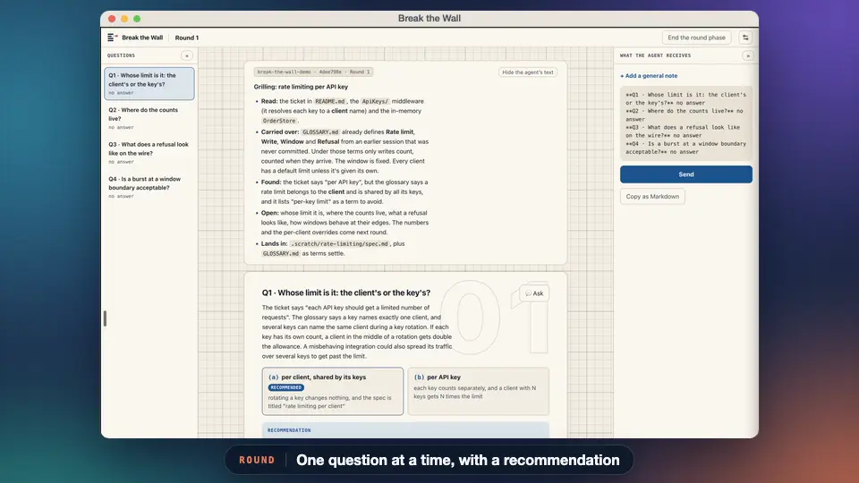
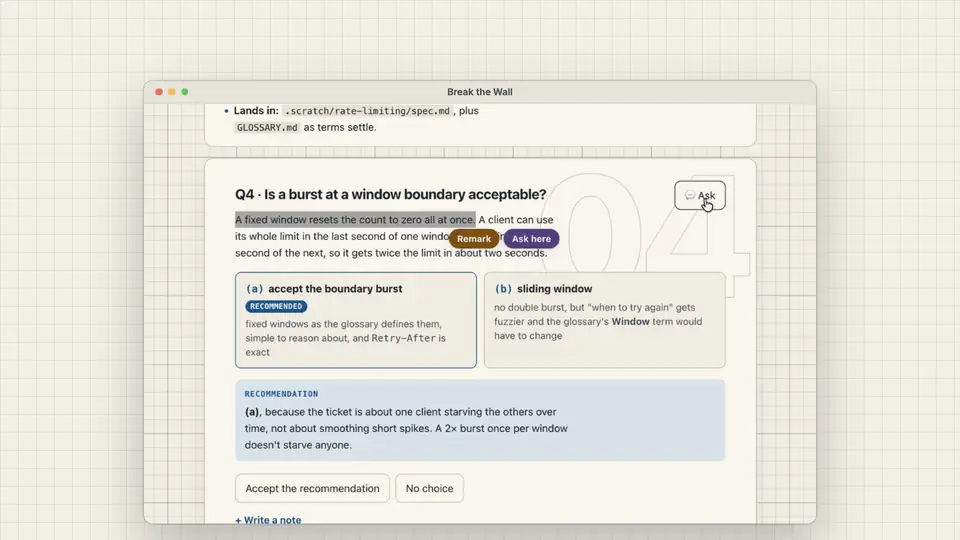
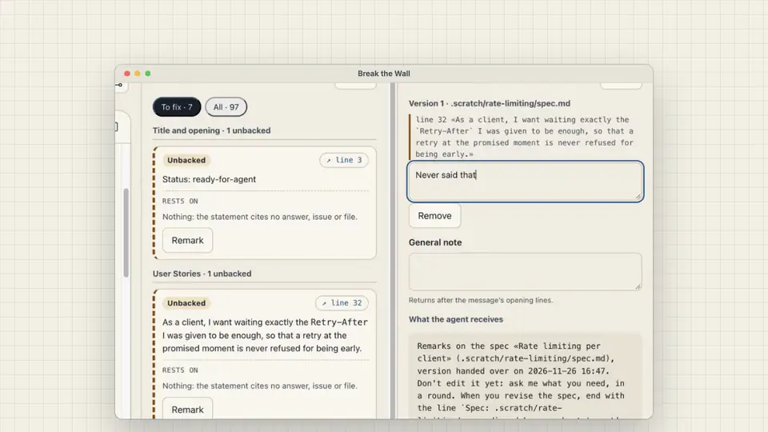

<p align="center">
  <picture>
    <source media="(prefers-color-scheme: dark)" srcset="docs/images/brand/wordmark-blueprint.svg">
    
  </picture>
</p>

<p align="center"><strong>Answer your agent's questions one at a time. Check the spec they lead to, line by line.</strong></p>

<p align="center">A Claude Code plugin for <a href="https://github.com/mattpocock/skills">Matt Pocock's grilling skills</a> · English &amp; Italian · Apache-2.0</p>

<p align="center">
  <a href="https://github.com/simoneriggi92/BreakTheWall/actions/workflows/ci.yml"></a>
  <a href="https://github.com/simoneriggi92/BreakTheWall/releases"></a>
  <a href="LICENSE"></a>
</p>

![A real Claude Code session beside the Break the Wall page: /break-the-wall opens the page beside the session; /grill-with-docs starts a grilling; the agent's questions arrive in the page, one at a time with a recommendation; a passage is selected and asked about in a side chat, which a read-only copy of the session answers; the round is accepted and sent, and only the answers go back to the terminal; Claude sends the next round, until nothing is left open; /to-spec writes the spec, which opens as its structure beside its source, down to the next layer; the statements without backing are listed, one gets the remark "Never said that", and Claude asks about it in a new round instead of guessing; the revised spec comes back and is approved](docs/images/use-in-claude-code.gif)

## Install

You need Claude Code 2.1.330 or later, and Node.js 22 or later on the `PATH` Claude Code starts with.

**1. The plugin.** In a shell:

```bash
claude plugin marketplace add simoneriggi92/BreakTheWall
claude plugin install break-the-wall@break-the-wall
```

The install says one option is not set yet: the side-chat model. Leave it empty to run side chats on the session's own model, or set it later with `/plugin configure break-the-wall@break-the-wall`.

**2. Matt Pocock's skills.** The plugin works with the grilling skills of [mattpocock/skills](https://github.com/mattpocock/skills), and does nothing without them: [`/grilling`](https://github.com/mattpocock/skills/tree/main/skills/productivity/grilling), [`/grill-me`](https://github.com/mattpocock/skills/tree/main/skills/productivity/grill-me) and [`/grill-with-docs`](https://github.com/mattpocock/skills/tree/main/skills/engineering/grill-with-docs) ask the rounds, and [`/to-spec`](https://github.com/mattpocock/skills/tree/main/skills/engineering/to-spec) hands over the spec they lead to. Install them from their own marketplace:

```bash
claude plugin marketplace add mattpocock/skills
claude plugin install mattpocock-skills@mattpocock
```

**3. `/break-the-wall`.** Start `claude` in your project and type `/break-the-wall`: the page opens in your browser, and its address is printed in case you close the tab. Then start a grilling, for example `/grill-with-docs` and the ticket you want to build, and its rounds arrive in the page.

Each command above took under four seconds in a clean Claude Code profile (2.1.332, `v1.0.0-rc.2`).

## How it works

<table>
<tr>
<td width="40%" valign="middle">

### Answer one question at a time

A grilling from Matt Pocock's skills asks its questions in rounds. In the page, each round shows one question at a time, its options side by side, the agent's recommendation marked, and the diagrams it draws. Accept the recommendation, choose another option, or write a note.

Send, and only your answers go back to the session: the agent goes on in the terminal.

</td>
<td width="60%">



</td>
</tr>
<tr>
<td width="40%" valign="middle">

### Ask beside the question

Select a passage of a question to remark on it, or ask about it in a side chat. A read-only copy of the session answers: it knows the conversation up to that question and reads the repository.

Nothing from a side chat reaches the agent unless you attach a reply to your answer.

</td>
<td width="60%">



</td>
</tr>
<tr>
<td width="40%" valign="middle">

### Check the spec, then approve

When `/to-spec` hands over the spec, it opens in the page as a source: its structure by levels, beside its lines. Each statement ends with what it rests on, an answer from a round, an issue or lines of a file, and the page flags those with no backing or a broken one.

Remark on a passage and send, and the agent asks the next round. When the spec is ready, **Approve** sends the agent one fixed message naming that version; what comes next is yours to type.

</td>
<td width="60%">



</td>
</tr>
</table>

## Why

A grilling is the best way to make an agent understand what you want, and the terminal is a poor place to read one. A round arrives as a wall of text: you scroll back to find which option was which, answer by number, and every side question you ask lands in the agent's conversation.

Then the spec arrives, another wall, written with the same confidence whether a sentence comes from your answers or was filled in. Nothing shows which is which.

Break the Wall keeps the agent, its skills and the terminal as they are, and changes where you read and answer: one question at a time, side questions kept beside it, and a spec you can check against what backs it. See the [product definition](docs/product.md).

## Reference

### Commands

| Command | What it does |
|---|---|
| `/break-the-wall` | Opens the page, or says it is already open; prints its address either way |
| `/break-the-wall:doctor` | Asks Claude why the page does not open (below) |

The skills of [mattpocock/skills](https://github.com/mattpocock/skills) are recognised by name, with or without their plugin's prefix (`/mattpocock-skills:grill-with-docs`): `grilling`, `grill-me` and `grill-with-docs` open the rounds, `to-spec` hands over the spec.

### Nothing opens?

Run `/break-the-wall:doctor`. It asks Claude to check Node, the policy settings and the debug log, and it is there even when a setting blocks the plugin's mod. What it looks for:

| Cause | How to recognise it | What to do |
|---|---|---|
| Node missing or older than 22 | `/break-the-wall` says "Break the Wall needs Node ≥ 22 on PATH" | Install Node 22 or later, or start Claude Code from a shell where `node --version` says 22 or later |
| `disableAllHooks` | `/break-the-wall` is missing from the `/` list while `/break-the-wall:doctor` is there. `claude plugin test`, run in an empty folder, says `hooks modules are turned off here` | Remove it from your own settings (`~/.claude/settings.json`, or the project's `.claude/settings.json` and `.claude/settings.local.json`); in your organization's managed settings, only an administrator can |
| `allowManagedHooksOnly` (organization) | The same signs as `disableAllHooks`; the debug log says `only managed plugins and built-in plugins run` | Ask your administrator |
| `allowManagedModsOnly` (organization) | `/break-the-wall` is missing, but `claude plugin test` reports nothing wrong; the debug log says `mods are limited to your organization's by policy (allowManagedModsOnly)` | Ask your administrator |
| `--safe-mode` | Neither `/break-the-wall` nor `/break-the-wall:doctor` is in the `/` list: safe mode loads no installed plugin | Start Claude Code without `--safe-mode` |

The debug log is written only for a session started with `claude --debug`, under `~/.claude/debug/` (`latest` points to the newest). Search it for `break-the-wall`.

### Update and uninstall

Auto-update is off for this marketplace, as for every marketplace outside Anthropic's own. To update:
1. `claude plugin marketplace update break-the-wall` reads the latest release;
2. `claude plugin update break-the-wall@break-the-wall` installs it (or, in `/plugin`, open **break-the-wall** on the **Installed** tab and choose **Update now**);
3. `/reload-plugins`, or start a new session.

To get updates on their own, turn auto-update on for `break-the-wall` on the **Marketplaces** tab of `/plugin`.

**To uninstall,** run `claude plugin uninstall break-the-wall@break-the-wall`, then `claude plugin marketplace remove break-the-wall`. Your history stays (below).

### Where your history lives

Rounds, drafts, answers and specs are kept on your computer, outside every repository, in the `rounds` folder of Break the Wall's data folder:
- macOS: `~/Library/Application Support/Break the Wall/rounds`
- Windows: `%APPDATA%\Break the Wall\rounds`
- Linux: `~/.config/Break the Wall/rounds` (or under `$XDG_CONFIG_HOME`)

It survives uninstalling the plugin. **To delete it,** end your Claude Code sessions and close the page, wait for the local server to stop (10 minutes after the last session and page), then delete the `rounds` folder. The rest of the data folder belongs to the desktop app.

### Platforms

Used on macOS. **Windows and Linux are not verified end to end:** on Windows the install and the launcher were witnessed, a full round was not; Linux has not been used. The server's tests run on both in CI.

### The desktop app

The desktop app that came before the plugin is frozen at [`v0.5.0-alpha`](https://github.com/simoneriggi92/BreakTheWall/releases/tag/v0.5.0-alpha); its demos, features, local models, tech stack and roadmap are in [docs/desktop-app.md](docs/desktop-app.md).

## Contributing

Contributions are welcome, from a bug report to a translation fix. Read [CONTRIBUTING.md](CONTRIBUTING.md) for the setup and the checks every change passes, and [Local development](docs/development.md) to build the plugin and run it from source.

- **Questions and ideas:** [Discussions](https://github.com/simoneriggi92/BreakTheWall/discussions).
- **Bugs and proposals:** [issues](https://github.com/simoneriggi92/BreakTheWall/issues/new/choose).
- **Security:** report privately, as described in [SECURITY.md](SECURITY.md).
- **Conduct:** everyone taking part follows the [Code of Conduct](CODE_OF_CONDUCT.md).
- **Changes:** each version is described in the [changelog](CHANGELOG.md).

## License

Break the Wall is licensed under the [Apache License 2.0](LICENSE). See [NOTICE](NOTICE) for attribution.
