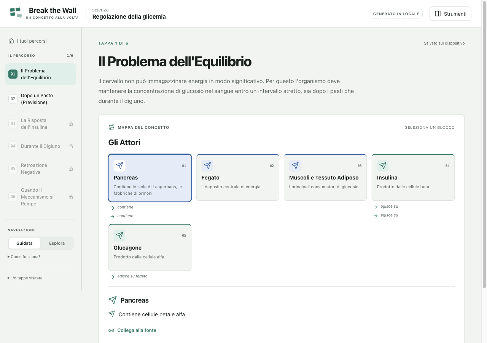
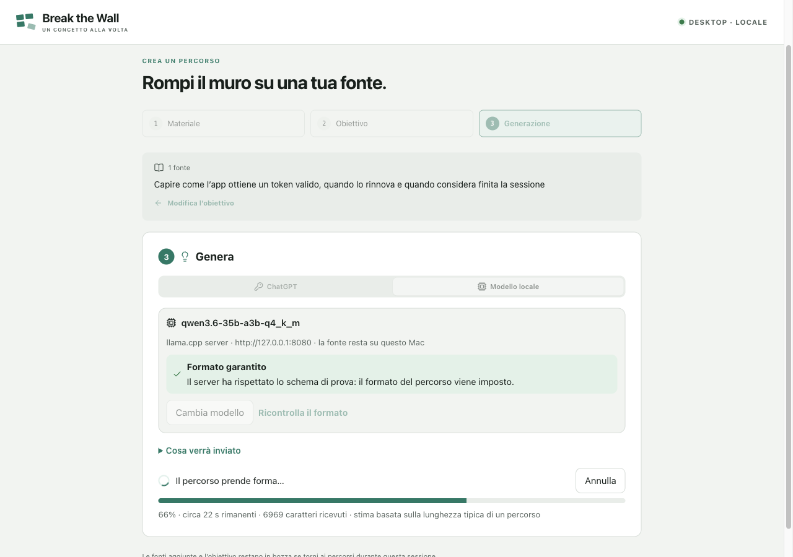

# Break the Wall

**Take apart whatever you want to understand (a source, a repository, a topic) and see how its parts work together. You have understood it when you can put it back together.**

Break the Wall turns a wall of text into bricks: a map of the parts, one part at a time in the representation that suits it (sequence, comparison, concept lens), and activities to rebuild it. Every part links to the exact lines of your source. It runs with your ChatGPT account or with a model on your own Mac.

**[Product](docs/product.md)** · **[Architecture](docs/architecture.md)** · **[Development](docs/development.md)** · **[Plan](docs/workflow/plans/P-20261021-first-learning-loop/plan.md)** · **[Status](STATUS.md)**




> [!NOTE]
> Break the Wall is an alpha that runs from source on macOS. There is no installer or release yet. Prepared examples work without any account.

## Table of contents

- [Why Break the Wall?](#why-break-the-wall)
- [Features](#features)
  - [Learning player](#learning-player)
  - [Source workspace](#source-workspace)
  - [Generation routes](#generation-routes)
  - [Validation and citations](#validation-and-citations)
  - [Progress and privacy](#progress-and-privacy)
- [Local models](#local-models)
- [Getting started](#getting-started)
- [Tech stack](#tech-stack)
- [Project status](#project-status)
- [Roadmap](#roadmap)
- [Contributing](#contributing)
- [License](#license)

## Why Break the Wall?

AI answers often arrive as a wall of text: correct-sounding, hard to retain and hard to check. Reverse engineering takes software apart, with evidence for every finding, so you can understand and rebuild it. Break the Wall applies the same principle to knowledge: **disassemble → run → reassemble**, with every part tied to its source. It is not a course, a summarizer or a flashcard app; review is there only if you want it. See the [product definition](docs/product.md).

| | A chat answer | Break the Wall |
|---|:---:|:---:|
| One idea per page, with a map of the whole | ❌ | ✅ |
| Representation chosen for the concept (map, sequence, comparison, lens) | ❌ | ✅ |
| Every claim linked to exact source lines | ❌ | ✅ |
| Predictions and reconstruction activities with specific feedback | ❌ | ✅ |
| Progress, attempts and notes that resume after restart | ❌ | ✅ |
| Can run with the source never leaving your computer | — | ✅ with a local model |

> [!IMPORTANT]
> Citations are verified, explanations are not. The app checks that every excerpt exists word for word in your source. A model can still attach a correct citation to a wrong explanation, so review what you learn against the highlighted lines.

## Features

### Learning player

- **Paced pages:** a left-hand route, one main representation per page, and guided or exploration mode.
- **Concept maps:** nodes with icons and labelled relationships ("depends on", "sends to", "causes").
- **Controllable sequences:** each frame shows before → action → after and moves the highlighted source lines with it.
- **Comparisons and concept lenses:** a lens covers what it is, why it matters here, how it works, and the critical point.
- **Activities:**
  - predictions, with feedback specific to each wrong option;
  - step reconstruction, which names the first misplaced step;
  - reflection compared against a reference.
- **Study tools:** a concept map, an atlas of concepts and page notes in one panel.

### Source workspace

- **Input:** pasted text, pasted code (with a language label), or `.txt` / `.md` files.
- **Limits:** up to 4 sources and 60,000 characters per lesson. Empty, non-UTF-8, binary and over-size input is rejected with a clear message.
- **Preview:** shows the numbered lines exactly as they will be sent. "Cosa verrà inviato" shows the complete request text before anything leaves the app.

### Generation routes

| Route | Account | Where your source goes | Output format | Status |
|---|---|---|---|---|
| **ChatGPT** | Sign in with ChatGPT; uses your plan | OpenAI, over the documented Responses API | strict JSON Schema | Sign-in witnessed; live inference pending |
| **Local model** | none | a server on `127.0.0.1` on your Mac | enforced per runtime; checked before use | Witnessed for code and non-code lessons |

While a lesson is generated, the app shows an estimated percentage and remaining time, and you can cancel. The ChatGPT route makes one request. The local route can add one automatic repair pass if the draft fails validation.

### Validation and citations

- **Citations:** the model writes each citation inside the block it supports, as a line range of one of your sources; the app copies the quoted lines.
- **No ids to get wrong:** the model marks the correct option and writes steps in their correct order. The app assigns every id and derives answers and gates, which removes the reference errors local models made most often.
- **Contract and quality checks:** findings are reported by page and block, before saving. The app rejects:
  - citations outside the source;
  - choices without exactly one correct answer;
  - pages that explain nothing;
  - routes without a map, with fewer than three representations, or written in a different language from your goal.
- **Safe normalizations:** the app never starts an order activity in its solution order, and it drops only what a learner could never reach.
- **Failures:** a failed or cancelled generation saves nothing and leaves earlier lessons and notes untouched.

### Progress and privacy

- **Storage:** lessons, progress, attempts and notes stay on your device, written atomically.
- **Credentials:** ChatGPT tokens are encrypted with the macOS Keychain (Electron `safeStorage`) and never reach the interface or the logs.
- **Isolation:** the renderer has no Node, filesystem or network access. Every desktop operation goes through narrow, validated IPC calls.



## Local models

Start a model server, open **Crea un percorso → Generazione → Modello locale**, and the app finds it. It probes the default ports and identifies each runtime by its own endpoints. Before first use, it sends a tiny probe to check whether the server really enforces the lesson format.

| Runtime | Default address | How the format is enforced | Observed on Ollama 0.30.8 / llama.cpp b9509 |
|---|---|---|---|
| llama.cpp server | `127.0.0.1:8080` | `/completion` with `json_schema` | ✅ enforced |
| LM Studio | `127.0.0.1:1234` | `response_format` JSON Schema | not yet tested |
| Ollama | `127.0.0.1:11434` | `format` | depends on the model: ✅ Qwen3.6, ⚠️ ignored for LFM2.5 (the app warns) |
| Other OpenAI-compatible server | any loopback port | `response_format` JSON Schema | depends on the server |

Measured on an M4 Pro with 48 GB, using Qwen3.6-35B-A3B (Q4_K_M) through llama.cpp: a lesson takes about 1–2 minutes. A smaller model, LFM2.5-24B-A2B, was faster but did not keep lesson references consistent. Details are in the [local inference trial](docs/workflow/research/R-20261022-local-inference.md).

```bash
llama-server -m Qwen3.6-35B-A3B-Q4_K_M.gguf -c 32768
```

> [!TIP]
> Use a model with at least ~30B parameters and a 32k context. Plan for 32 GB of memory or more. Only addresses on this machine are accepted, so your source never leaves the computer on this route.

## Getting started

**Requirements:** macOS, Node.js 22.23.2 and npm 10.9.8 (versions pinned in `package.json`).

```bash
npm ci
npm run build
npm start
```

**Development**

```bash
npm run dev       # Vite + Electron with reload
npm run check     # strict TypeScript + Vitest
npm run dev:web   # renderer only, in a browser (no generation)
npm run eval      # measure generation on fixed cases (see Local development)
```

Set `BTW_USER_DATA_DIR` to an absolute path to keep test data separate from your own. More details are in [Local development](docs/development.md).

## Tech stack

| Layer | Stack |
|---|---|
| Desktop host | Electron 45: sandboxed renderer, context isolation, custom `btw://` protocol |
| Interface | React 19, TypeScript 7, Vite 8, lucide icons, system fonts |
| Lesson model | zod 4 contracts, independent of React and Electron |
| AI routes | Sign in with ChatGPT (OAuth + PKCE, Responses API); Ollama, LM Studio and llama.cpp over loopback |
| Storage | atomic JSON files in the app's data folder; credentials via Keychain-backed `safeStorage` |
| Tests | Vitest, Testing Library (jsdom), DevTools-protocol scripts for the desktop build |

## Project status

Work follows an approved [plan](docs/workflow/plans/P-20261021-first-learning-loop/plan.md). Evidence for each task is recorded in the [player](docs/workflow/plans/P-20261021-first-learning-loop/player-verification.md) and [generation](docs/workflow/plans/P-20261021-first-learning-loop/generation-verification.md) verification notes.

| Task | | Status |
|---|---|---|
| T1–T3 | Desktop shell, lesson contracts, reusable player with two prepared lessons | ✅ verified |
| T4 | Import and preview a bounded text source | ✅ verified |
| T5 | Sign in with ChatGPT and live inference | 🟡 sign-in witnessed; inference waiting for plan usage |
| T5b | Generate with a local model, chosen in the app | ✅ verified live |
| T6 | Generate, validate, save and resume | ✅ verified through the local route |
| T7 | Alpha verification and feedback | ⏳ not started |

Not claimed: general learning effectiveness, correctness of generated explanations, platforms other than macOS, or installer distribution.

## Roadmap

- [x] Reusable player for code and non-code topics
- [x] Text and Markdown import with exact preview
- [x] Generation with a local model, with format check and repair pass
- [ ] Live ChatGPT generation witnessed end to end
- [ ] Alpha verification with learners beyond the owner
- [ ] AI-assisted source discovery from the web, with retrievable citations
- [ ] PDF and repository adapters
- [ ] Packaged, signed macOS build

## Contributing

The project uses a research → plan → approve → implement → verify workflow. Read [AGENTS.md](AGENTS.md) for repository constraints and the active plan before proposing changes. Fixtures must be original or suitably licensed: the repository is public.

## License

No license has been selected yet. The intended distribution is open source, but until a license is added, publishing the source does not grant reuse rights.
