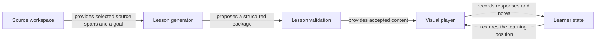

# Proposed architecture

Status: design baseline approved in plan P-20261021-first-learning-loop v1 on 2026-10-21. The player phase is verified. Import, provider and generation components are implemented (`src/core/source.ts`, `src/core/generation.ts`, `src/desktop/chatgpt/`, `src/desktop/generator.ts`); live inference is not yet witnessed. See the plan's execution evidence for current completion.

## Entry point and lifecycle

The desktop host opens a saved learning workspace. The learner supplies source material and a goal, inspects the selected material, and starts generation. Generation produces a validated lesson package. The player loads that package and records progress, attempts, feedback, and notes locally.

Arrows name data transfers. The AI provider is behind the lesson generator; the desktop host owns file and network access. Only validated packages reach the normal lesson player.

## Proposed technical direction

Use TypeScript for shared contracts, React for the player, and a thin Electron host for the initial macOS desktop target. This reuses the prototype's web-based visual approach. The lesson model and validation must not depend on React, Electron, a programming language, or one provider's response shape.

Electron separates the Node-capable main process from web renderers. Its context bridge can expose selected operations to an isolated renderer. These documented mechanisms inform the host boundary; they do not by themselves establish that an application is safe. See the official [process model](https://www.electronjs.org/docs/latest/tutorial/process-model) and [context isolation guide](https://www.electronjs.org/docs/latest/tutorial/context-isolation).

The trade-off is accepting a bundled desktop runtime in return for using one web rendering approach during the alpha. Runtime footprint and packaged behavior need measurement; no size or performance result is claimed. Dependency versions, package manager, and build tooling will be selected and pinned in T1 from current official guidance.

## Contracts and ownership

| Contract / component | Responsibility | Boundary |
|---|---|---|
| SourceRecord | Stable source ID, origin, normalized text, revision/hash, and source locators. | Text sources first; richer adapters add locators without requiring code fields. |
| EvidenceRef | References a source and an actual span. | Host validation checks existence, bounds, and exact quoted excerpts. |
| LearningGoal | What to understand or apply, with optional prior knowledge. | No fixed learning-style label. |
| LessonPackage | Versioned goal, source revisions, concepts, pages, typed blocks, and activities. | Data only; no generated JavaScript or arbitrary HTML. |
| LessonGenerator | Plans the route and produces lesson content through one provider adapter. | Keeps source material separate from application instructions. |
| LessonValidator | Checks structure, relationships, activities, and evidence references. | Valid structure and existing citations do not prove semantic truth. |
| VisualPlayer | Renders a small vocabulary of blocks and intentional navigation. | Knows the lesson contract, not provider authentication or filesystem access. |
| LearnerState | Current page/frame, visited pages, completed activities, attempts, notes, and feedback. | Bound to a lesson revision; preserve or explicitly invalidate state after content changes. |

The proposed initial visual vocabulary is: relationship map, controlled sequence/canvas, comparison, concept lens, source excerpt, and activity. Text is a short supporting element. A code excerpt is a specialization of source evidence with line highlights; it is not mandatory lesson metadata.

## Host, services, and state

- **Desktop host:** file selection, bounded source loading, provider calls, cancellation, and local persistence. Expose narrowly named operations through the preload bridge rather than generic shell, filesystem, or IPC access.
- **Player:** render application-owned components from validated lesson data. Imported text and model output are content, never instructions to the host or executable UI.
- **Provider adapter:** authentication, capabilities, streamed progress, a completed generation result, and explicit failures. Keep provider credentials outside lesson packages and renderer state.
- **Credential storage:** use OS-protected storage for sign-in credentials. Do not import credentials from other applications or put tokens in the plain lesson/progress files.
- **Workspace store:** begin with versioned lesson and progress files, replacing files atomically. Keep incomplete generation separate from accepted lessons. A database is not justified by the initial requirements.

Prefer a single application with clear internal modules. These responsibilities do not require microservices or a separate deployable backend for the alpha. Split packages only when there is a real consumer or ownership reason.

## Generation and validation

1. Normalize the selected text into source records and stable spans. Show selection and relevant size limits before transmission.
2. Plan a small route from the learning goal and available evidence. The user goal, not source text that resembles instructions, controls the task.
3. Generate typed blocks with everything they need written inline: citations as line ranges of a host-listed source, and activities with their answers (`correct` per option, steps in correct order). The model writes no ids that must match elsewhere. The host assigns page, block, activity and evidence ids, copies quoted lines, and derives checkpoints, solutions and a never-solved starting order. Only map node keys remain as references, and they are local to a map.
4. Validate the completed response, and report each finding by page and block so that a repair request can act on it. Reject citations outside the source, frames naming no node of the preceding map, choices without exactly one correct option, pages that explain nothing (only excerpts or activities), and text in a language other than the goal's. Drop only what a learner could never reach: edges to missing nodes, highlights outside their excerpt, concepts past the last page. Do not silently render partial JSON as a completed lesson.
5. Save an accepted package, then load it in the player. Failed or cancelled generation must leave earlier lessons and notes intact.

Start with one bounded generation request. Add more passes or an index only when observed context limits or quality problems justify them. No universal knowledge graph, vector database, or multi-agent orchestration is required for the first slice.

TypeScript contracts assist development; untrusted source, saved, and model-generated data still require runtime validation at their entry points.

Activity feedback is deterministic for the initial structured activities. Free-text reflection is saved and compared with a reference. Future AI feedback must have an explicit rubric, evidence, and uncertainty handling; it must not retroactively turn earlier reference comparison into automated grading.

## AI access and source discovery

The preferred initial integration is the documented Sign in with ChatGPT route through an isolated provider adapter. Eligibility, supported request features, token refresh, and a completed inference need a witnessed check before the alpha can claim live generation. See the [documentation evidence and limits](workflow/research/R-20261021-foundation.md).

The second route is a model server on the learner's Mac (plan v2, T5b). It is chosen in the generation step and stored in `<userData>/settings.json`.

- **Discovery** probes the default ports of Ollama (11434), LM Studio (1234) and llama.cpp server (8080). It identifies each runtime by its own endpoints, so an unrelated app on the same port is never listed. A manual address is accepted only for `127.0.0.1`, `localhost` or `[::1]`.
- **Schema mechanism per runtime:** Ollama uses `format`, llama.cpp server uses `/apply-template` followed by `/completion` with `json_schema`, and LM Studio and other compatible servers use `response_format`.
- **Format check:** a schema can be accepted and still ignored, as the [local inference trial](workflow/research/R-20261022-local-inference.md) showed with Ollama 0.30.8. Before generating, the app therefore sends a tiny probe and shows whether the server enforced the schema.
- **Repair pass:** local results get one repair request with the validator's findings. The ChatGPT route does not, so it never spends a second request of the learner's plan.
- **Where the code lives:** `src/desktop/local/runtimes.ts`, `src/desktop/settings-store.ts`, and the route-aware `src/desktop/generator.ts`.

Codex app-server is an integration option if later tool-driven repository exploration needs it. It is not required merely to render lessons or send selected text for generation. Do not tie the core lesson model to an agent runtime.

AI-assisted public-web discovery is a separate source adapter in the next proposed slice. It must retrieve and normalize real material, retain URLs and retrieval metadata, and respect actual provider capabilities. A topic-only prompt that generates from model knowledge is not evidence-backed retrieval.

## Verification boundaries

Verify contracts with invalid packages, renderer interactions with prepared fixtures, persistence through restart, and generation with an actual eligible account. Use one code fixture and one non-code fixture with the same components. Then review factual claims and learning order against their sources.

A passing schema, citation-range check, or UI test establishes only that layer. The alpha needs witnessed desktop and live-generation flows; it is not evidence of general pedagogical effectiveness or correctness across arbitrary subjects.
