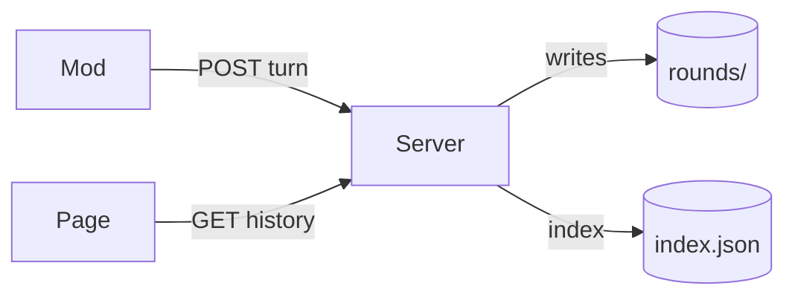
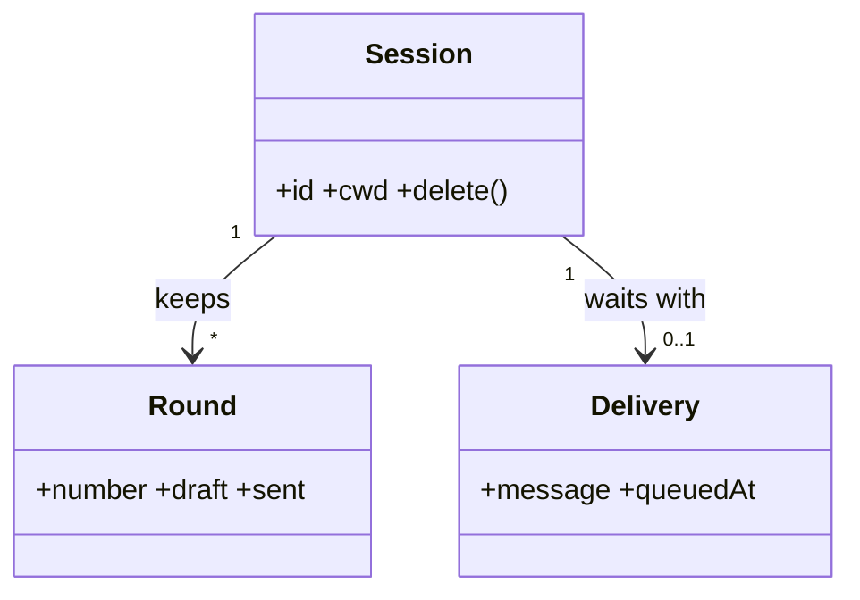

I read the server, the mod and the page. Four decisions are open before the history column can be built; the first two shape the storage, the last two only the page.

❓ **Q1** - **Where does a round's history live?**: The server already writes every round it receives into the per-user data folder, one file per round, replaced atomically. The history column needs to list them by project and session without reading every file at start, because a person who grills for weeks collects hundreds of rounds.

⚠ An index can drift from the files it lists if the server stops between the two writes.

- **(a)** One index file: one read at start; it must be rebuilt when it drifts from the rounds.
- **(b)** A folder walk at start: always right; slower with hundreds of rounds.
- **(c)** Both: walk once, then keep an index in memory only; nothing to drift on disk.

➡️ **(c)**, since the walk is paid once per server start and nothing on disk can disagree.

❓ **Q2** - **Who decides that a session has ended?**: Claude Code raises `session.end` on exit, but not on a crash or a closed terminal. The server also sees registrations stop being renewed every 30 seconds.

- **(a)** The mod: ends it on `session.end`; a crash leaves it live forever.
- **(b)** The server: ends it when renewals stop; a sleeping laptop ends a live session.
- **(c)** Both: `session.end` ends it at once, the missing renewal after ten minutes.

➡️ **(c)**: the explicit signal when there is one, the timeout as the floor.

❓ **Q3** - **What does a deleted session leave behind?**: Deleting from the page removes the session's rounds, drafts and side chats. A queued delivery for that session may still be waiting for `claude --resume`.

➡️ Remove the queued delivery too, and say so in the confirmation.

❓ **Q4** - **How does the history column order sessions?**: By the latest round received, or by the project, then the date.

- **(a)** Latest round first: the session being worked on is always on top.
- **(b)** Project, then date: stable, but the live session moves around less predictably.

➡️ **(a)**.
